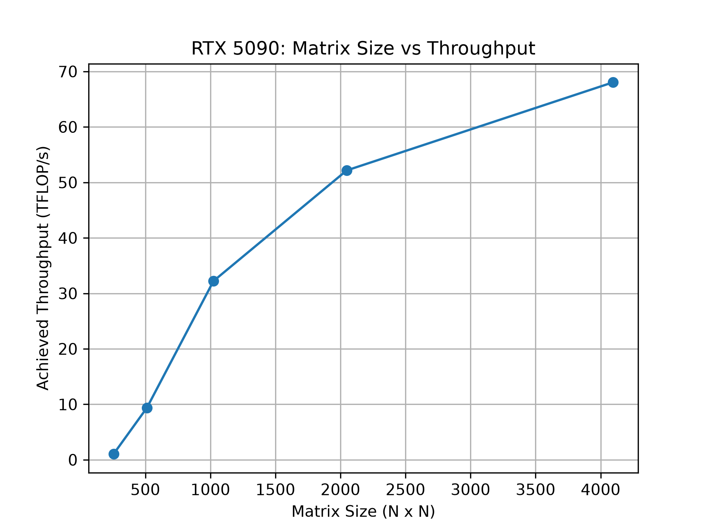
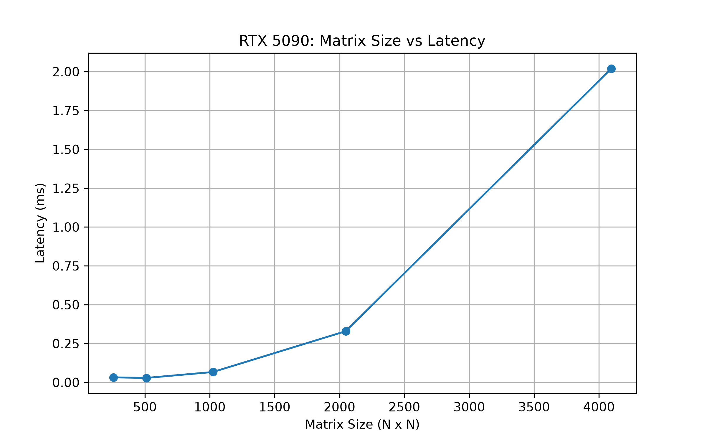

# GPU-Accelerated Deep Learning & AI-Driven Performance Optimization

**An independent, experiment-driven exploration of GPU performance modeling, Triton kernel autotuning, and profiler-guided optimization.**

Built as an undergraduate Computer Science research portfolio at **Texas State University**, this repository investigates how GPU workloads behave, whether machine learning can recommend efficient execution configurations, and how hardware measurements can verify an optimization decision.

The work progresses from CUDA/PyTorch fundamentals to measured GPU kernels, supervised performance models, and a small evidence-guided optimization prototype. Its emphasis is on **correctness, reproducibility, and measured outcomes** rather than unverified speedup claims.

## At a Glance

| Experiment | Result | Scope |
|---|---|---|
| GPU performance prediction | Random Forest test MAE: **0.010719 ms** (mean relative error: 11.56%) | PyTorch matrix multiplication; 18 held-out workloads |
| Triton configuration dataset | **120 workload shapes**, **4 configurations**, **3 trials** = **1,440 measurements** | FP16 matrix multiplication on one RTX 5090 |
| ML-guided configuration selection | MLP mean test selection regret: **3.12%**, versus **9.19%** for a fixed configuration | Offline evaluation; 18 held-out shapes; four candidate configurations |
| Evidence-guided A/B case study | **1.119×** speedup for configuration B versus A | One workload; five paired CUDA Graph timing trials; correctness checked |

**How to interpret these results:** The autotuning comparison is **offline**: the candidate latencies were measured in advance, and the evaluation estimates selection quality, not total online tuning time. The case-study speedup applies only to the tested workload and configurations. Neither result establishes general performance gains across kernels or GPUs.

**Start here:** [Milestone 4 technical details](milestone-04-performance-ml/README.md) · [Research report](docs/research_report.md) · [Optimization case study](docs/optimization_case_study.md)

## Research Focus

GPU performance depends on more than the number of floating-point operations. Matrix dimensions, execution tiles, parallelism, memory behavior, and hardware resource limits can all affect latency. A configuration that works well for one workload may be less effective for another.

This project explores three connected questions:

1. **Performance modeling:** How accurately can statistical models and neural networks predict GPU execution latency from workload characteristics?
2. **ML-guided autotuning:** Can a learned model recommend low-latency Triton configurations for previously unseen matrix shapes?
3. **Evidence-guided optimization:** How can profiler measurements, correctness checks, and fresh timing results support an accept/reject decision when a learned recommendation is imperfect?

The long-term interest is in combining **deep learning model development** with **AI-assisted HPC performance optimization**. The current implementation is a limited research prototype, not a general-purpose compiler or autonomous optimization agent.

## Experimental Workflow

```text
GPU workloads (M, N, K)
       |
       v
PyTorch / Triton benchmarks -----> measured latency datasets
       |                                      |
       v                                      v
Data-quality checks                 ML performance predictors
       |                                      |
       +------------------------------> configuration ranking
                                              |
                                              v
                                 Select candidate configuration
                                              |
                          Nsight Compute diagnostics + correctness
                                              |
                                              v
                                   Fresh CUDA Graph benchmark
                                              |
                                              v
                                    Accept / reject + report
```

The workflow combines a **predictive component** (latency and configuration ranking) with a **verification component** (profiling, numerical tests, and measurement). Profile-based recommendations in the final case study are controlled and predefined; the system does not autonomously synthesize or rewrite GPU kernels.

## Project Milestones

| Milestone | Focus | Main deliverables |
|---|---|---|
| [01 — Environment](milestone-01-environment/) | CUDA-enabled development setup | GPU detection and environment verification |
| [02 — Foundations](milestone-02-foundations/) | Threads, warps, memory hierarchy, tensor operations, tiling | CPU/GPU tensor correctness experiment and concept notes |
| [03 — Benchmarking](milestone-03-benchmarking/) | GPU latency, throughput, variability, and profiling | CUDA-event benchmarks, CSV summaries, PyTorch Profiler, visualizations |
| [04 — Performance ML & Optimization](milestone-04-performance-ml/) | Prediction, Triton kernels, learned autotuning, and hardware diagnostics | Trained models, configuration dataset, held-out policy comparison, Nsight evidence, A/B optimization report |

### Milestone 03 — Benchmarking Baseline

Square FP32 matrix multiplication was evaluated from **256 × 256** through **4096 × 4096**, using CUDA events, warmup iterations, repeated timing batches, and estimated throughput based on the conventional `2N³` FLOP count.

| Matrix size | Median latency (ms) | Estimated throughput (TFLOP/s) |
|---|---:|---:|
| 256 × 256 | 0.0322 | 1.04 |
| 512 × 512 | 0.0286 | 9.37 |
| 1024 × 1024 | 0.0666 | 32.23 |
| 2048 × 2048 | 0.3294 | 52.16 |
| 4096 × 4096 | 2.0200 | 68.04 |

These are measurements from the original benchmarking study, not hardware peak specifications.

| Throughput | Latency |
|---|---|
|  |  |

See [Milestone 03](milestone-03-benchmarking/) for methodology, summaries, and profiling code.

### Milestone 04 — Performance Prediction and Optimization

**A. Workload-level latency prediction.** A dataset of **120 distinct matrix shapes**, each measured over repeated trials, was split by workload into **84 training, 18 validation, and 18 test shapes**. Constant, log-linear, Random Forest, and PyTorch MLP predictors were evaluated. Random Forest had the lowest held-out latency prediction MAE (**0.010719 ms**) in this study. A separate data-efficiency experiment varied the number of training shapes; its results are exploratory.

**B. Configurable Triton matrix multiplication.** A custom FP16 Triton kernel was implemented with parameters for `BLOCK_M`, `BLOCK_N`, `BLOCK_K`, and `num_warps`. Configurations were checked against PyTorch numerical results, then measured using CUDA Graph replay. The four-configuration experiment generated **1,440 trial measurements**, aggregated to **480 workload–configuration pairs**, with workload-disjoint train/validation/test splits.

**C. Learned configuration selection.** Random Forest and MLP models predicted candidate latency for each workload–configuration pair. Their recommendations were compared offline with a training-selected fixed policy, simulated random search, and the best of all four premeasured configurations (oracle). On 18 held-out shapes:

| Policy | Candidate measurements per shape* | Mean selection regret | Within 5% of best |
|---|---:|---:|---:|
| **MLP recommendation** | **1** | **3.12%** | **83.3%** |
| Random Forest recommendation | 1 | 3.95% | 72.2% |
| Fixed configuration | 1 | 9.19% | 66.7% |
| Random search (3 candidates) | 3 | 5.28% | 84.7% |
| Exhaustive four-config oracle | 4 | 0.00% | 100% |

*Evaluation counts describe the modeled selection/verification budget; they exclude offline data collection, training, inference, compilation, and other tuning overheads. The exhaustive policy is an oracle within this restricted set, not a free online result.*

**D. Profiler-guided A/B optimization.** For workload `(M, N, K) = (512, 1024, 256)`, Nsight Compute showed that configuration A had **12.51% achieved occupancy**, while B had **8.31%**. The frozen MLP predicted A would be faster. However, fresh CUDA Graph measurements found **3.098 µs for A** and **2.768 µs for B** (medians), a **1.119×** speedup for B. Both passed correctness tests, and B was faster in all five paired timing rounds. The decision logic provisionally accepted B; the precise hardware cause of the difference remains a hypothesis.

For detailed methodology and saved evidence, see the [research report](docs/research_report.md) and [optimization case study](docs/optimization_case_study.md).

## Repository Layout

```text
gpu-deep-learning-research/
├── milestone-01-environment/      # GPU setup checks
├── milestone-02-foundations/      # Tensor experiments and concepts
├── milestone-03-benchmarking/     # CUDA-event benchmarks, CSVs, plots
├── milestone-04-performance-ml/   # Performance models, Triton and autotuning
│   ├── collect_data.py
│   ├── prepare_dataset.py
│   ├── train_baselines.py
│   ├── train_mlp.py
│   ├── triton_matmul.py
│   ├── benchmark_triton.py
│   ├── prepare_autotuning.py
│   ├── train_autotuner.py
│   ├── train_autotuner_mlp.py
│   ├── compare_search_strategies.py
│   ├── final_autotuning_evaluation.py
│   ├── evidence_guided_optimizer.py
│   ├── data/                    # Raw and processed measurements
│   ├── results/                 # Checkpoints, tables, profiling reports
│   └── README.md                # Full Milestone 04 documentation
├── docs/
│   ├── research_report.md
│   └── optimization_case_study.md
└── README.md
```

The layout is abbreviated for readability; the milestone-specific README files describe individual scripts and artifacts.

## Experimental Environment

| Component | Environment |
|---|---|
| GPU | NVIDIA GeForce RTX 5090 (32 GB VRAM) |
| CPU | AMD Ryzen 7 7800X3D |
| System memory | 32 GB DDR5 |
| OS | Windows 11, WSL2 Ubuntu 24.04 |
| Python | 3.12 |
| PyTorch / CUDA build | 2.15.0+cu132 / CUDA 13.2 |
| Triton | 3.9.0 |
| NVIDIA Nsight Compute | 2026.4 |
| Other tools | NumPy, scikit-learn, Matplotlib, PyTorch Profiler, Git, VS Code |
| Precision | FP32 (`highest`) for the introductory PyTorch benchmarks; FP16 inputs with FP32 accumulation for Triton experiments |

Results are hardware-, configuration-, and measurement-method-dependent. GPU profiling overhead must not be confused with steady-state CUDA Graph runtime.

## Reproducing the Work

A compatible NVIDIA GPU, a working CUDA-enabled PyTorch installation, and Python are required. Follow the [official PyTorch installation instructions](https://pytorch.org/get-started/locally/) for a build compatible with your system; do not assume that the locally tested CUDA build is available on every machine.

```bash
# From the repository root, with your Python environment activated
python -m pip install numpy scikit-learn joblib matplotlib triton

# Foundational CUDA-event benchmark
cd milestone-03-benchmarking
python benchmark_matmul.py
python summary_result.py
python plot_results.py
```

The Milestone 4 pipeline has dependencies between collection, preparation, training, and evaluation. Consult its [technical README](milestone-04-performance-ml/README.md) before rerunning it. A representative sequence is:

```bash
cd ../milestone-04-performance-ml
python collect_data.py
python prepare_dataset.py
python train_baselines.py
python train_mlp.py

# Triton configuration measurements and modeling
python benchmark_triton.py
python prepare_autotuning.py
python train_autotuner.py
python train_autotuner_mlp.py
python compare_search_strategies.py
python final_autotuning_evaluation.py
```

`benchmark_triton.py` uses a smoke/full-run switch; choose the intended mode before collecting data. The profiling/evidence case study additionally requires supported Nsight Compute tooling, locally saved profiling reports, and the trained MLP checkpoint. See its documentation for the execution order and prerequisites. Repeating training or benchmark collection may overwrite saved outputs, so preserve existing results before rerunning.

## Limitations and Next Steps

This is a **single-GPU, matrix-multiplication-focused prototype**. It evaluates only four Triton configurations and a small held-out workload set. Model-based policy comparisons use precollected measurements, so they do **not** establish reduced end-to-end online tuning time. The final evidence-guided A/B case study tests a predefined configuration change; it does not autonomously generate kernel code or reproduce the full OPTIMAS architecture.

Potential extensions include broader kernel/configuration coverage, evaluation across multiple GPU architectures, uncertainty-aware ranking, explicit online optimization cost accounting, and applying the methodology to additional deep learning operators.

## References

- [NVIDIA CUDA C++ Programming Guide](https://docs.nvidia.com/cuda/cuda-c-programming-guide/)
- [PyTorch documentation](https://docs.pytorch.org/docs/stable/)
- [PyTorch Profiler tutorial](https://docs.pytorch.org/tutorials/recipes/recipes/profiler_recipe.html)
- [Triton documentation](https://triton-lang.org/)
- [NVIDIA Nsight Compute](https://developer.nvidia.com/nsight-compute)
- [CoffeeBeforeArch CUDA examples](https://github.com/CoffeeBeforeArch/cuda_programming)

## About This Project

This is independently developed undergraduate research preparation focused on the intersection of **deep learning systems and high-performance computing**. The project is informed by literature on performance modeling, hardware-aware autotuning, and diagnostic-guided optimization, including work associated with Per4ML and OPTIMAS; it is **not** affiliated with or an implementation of those research projects.
