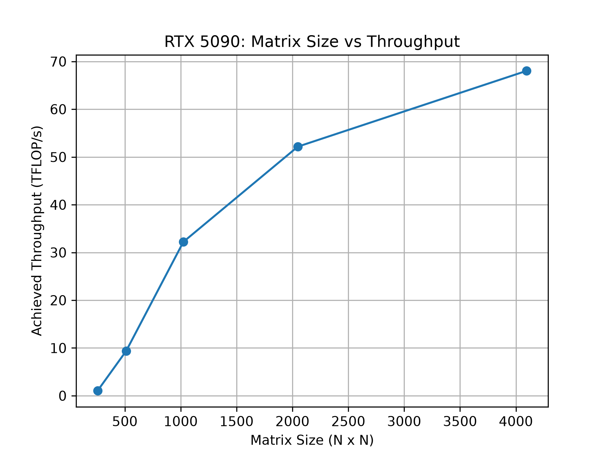
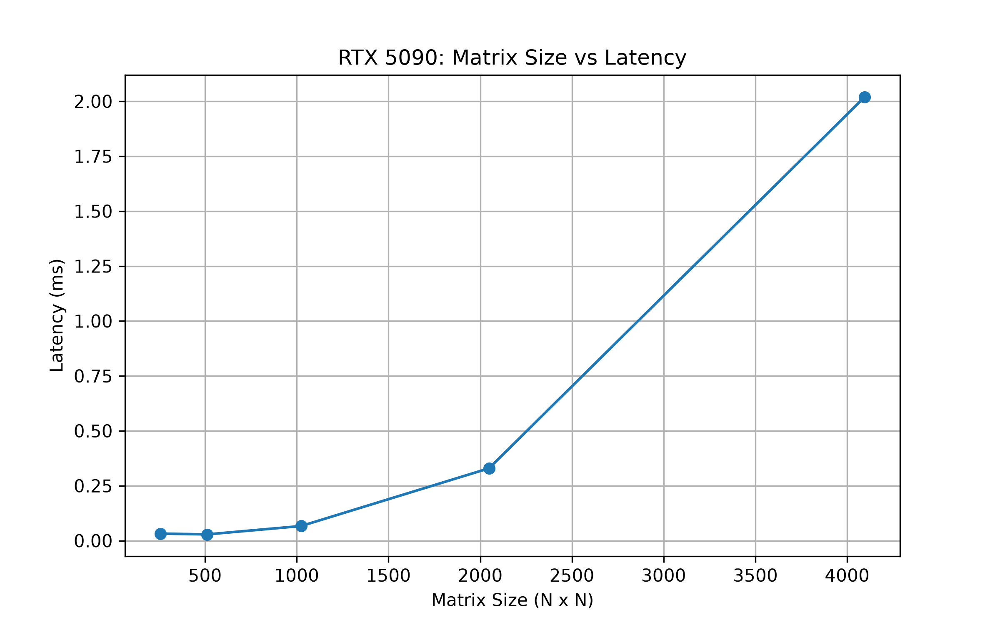

# Milestone 3 — GPU Matrix Multiplication Benchmarking and Profiling

A hands-on GPU performance study using **PyTorch**, **CUDA events**, and **PyTorch Profiler** on an **NVIDIA GeForce RTX 5090**. This project is part of my preparation for undergraduate research in GPU computing, deep learning systems, and performance optimization.

## Objective

Investigate how square matrix multiplication size affects **execution latency** and **achieved computational throughput**, and practice building a reproducible benchmarking and analysis workflow.

Questions explored:
- How does matrix multiplication latency change as matrix size increases?
- How does achieved TFLOP/s change with workload size?
- How consistent are repeated timing measurements?
- What CPU-side and GPU-side activities does PyTorch Profiler report?

## Experimental environment

| Component | Configuration |
|---|---|
| GPU | NVIDIA GeForce RTX 5090 |
| PyTorch | `2.15.0+cu132` |
| CUDA version reported by PyTorch | `13.2` |
| Matrix input dtype | `torch.float32` |
| FP32 matmul precision setting | `highest` |
| Development environment | Linux terminal and Python virtual environment (exact OS/Python versions not recorded here) |

These settings were captured from my local environment. The CUDA version above is the **CUDA build reported by PyTorch**; it is not necessarily the installed system CUDA Toolkit version.

## Methodology

For square matrices of size **N × N**, I benchmarked `C = A @ B` with `A` and `B` created directly on the GPU using PyTorch.

- **Matrix sizes:** 256, 512, 1024, 2048, and 4096
- **Warmup:** 10 matrix multiplications for each matrix-size/batch combination
- **Timing:** CUDA start/end events with synchronization before reading elapsed time
- **Measurements:** 20 timed multiplications per batch
- **Repeated batches:** 5 per matrix size (25 batch summaries in total)
- **Statistic within a batch:** Median latency across the 20 timings
- **Across-batch summary:** Median, minimum, maximum, and **sample standard deviation** of the five batch medians

The estimated floating-point operation count for an N × N matrix multiplication is:

\[
\mathrm{FLOPs} \approx 2N^3
\]

Achieved throughput is calculated from the **median of batch medians**:

\[
\mathrm{TFLOP/s} = \frac{2N^3}{\mathrm{median\ latency\ (ms)}\times10^9}
\]

This is an estimate based on the conventional operation count, not a direct measurement of hardware instructions.

## Results

| Matrix size | Median latency (ms) | Sample std. dev. of batch medians (ms) | Estimated throughput (TFLOP/s) |
|---|---:|---:|---:|
| 256 × 256 | 0.0322 | 0.0018 | 1.04 |
| 512 × 512 | 0.0286 | 0.0019 | 9.37 |
| 1024 × 1024 | 0.0666 | 0.0090 | 32.23 |
| 2048 × 2048 | 0.3294 | 0.0183 | 52.16 |
| 4096 × 4096 | 2.0200 | 0.0073 | 68.04 |

Detailed batch-level and summary results are saved in `matmul_results.csv` and `matmul_summary.csv`.

### Throughput vs. matrix size



### Latency vs. matrix size



### Observations

1. **Estimated achieved throughput rose with matrix size**, from approximately 1.04 TFLOP/s at 256 × 256 to 68.04 TFLOP/s at 4096 × 4096. Larger workloads may make more effective use of available GPU parallelism, but this benchmark alone does not establish the exact cause.
2. **Latency generally increased for larger matrices**, even while throughput improved. Larger matrices require substantially more arithmetic work.
3. **The 512 × 512 workload had a slightly lower median latency than the 256 × 256 workload.** This may involve fixed overheads, different kernels, or measurement variability; the present data cannot isolate the explanation.
4. **The 1024 × 1024 batch medians varied more relative to their median** than the 4096 × 4096 measurements. The standard deviations here characterize the five batch medians, not all 100 individual timings.

## GPU profiling

I used `profile_matmul.py` with **PyTorch Profiler** to examine **10 warmed-up 1024 × 1024 GPU matrix multiplications**. The profiler reported:

- `aten::matmul` and `aten::mm` operations on the PyTorch side
- CUDA kernel-launch and synchronization activity on the CPU side
- A GPU kernel with a name beginning `cutlass::Kernel2<cutlass_80_simt_sgemm...`
- Approximately **431.373 µs aggregate CUDA time** attributed to `aten::mm` across 10 calls (about **43.137 µs/call**)
- Approximately **42.204 µs/call** associated with the listed CUTLASS GPU kernel

These represent different views of overlapping execution; the `aten::mm` and kernel times **should not be added together**. The profiler also showed substantial CPU-side activity associated with trace collection (`Activity Buffer Request`). **Profiler timings are not directly comparable with the CUDA-event benchmark**, because profiling itself adds overhead and uses a different measurement approach.

## Project files

```text
milestone-03-benchmarking/
├── benchmark_matmul.py     # GPU timing and per-batch CSV collection
├── summary_result.py       # Statistics across batches
├── plot_results.py         # Latency and throughput figures
├── profile_matmul.py       # PyTorch Profiler experiment
├── matmul_results.csv      # 25 batch-level rows
├── matmul_summary.csv      # 5 matrix-size summaries
├── throughput.png          # Final throughput figure
├── latency.png             # Final latency figure
└── README.md
```

## How to reproduce

Run the following commands **from `milestone-03-benchmarking/`** in a working environment with a CUDA-capable PyTorch installation and Matplotlib. Use the [official PyTorch installation selector](https://pytorch.org/get-started/locally/) to choose a GPU-compatible build.

```bash
python -m pip install matplotlib
python3 benchmark_matmul.py
python3 summary_result.py
python3 plot_results.py
python3 profile_matmul.py
```

`benchmark_matmul.py` writes `matmul_results.csv`; `summary_result.py` reads it and writes `matmul_summary.csv`; `plot_results.py` reads that summary to generate `throughput.png` and `latency.png`. **Running the benchmark again overwrites its CSV results** and may produce different measurements.

## Limitations and next steps

- This is a **single-GPU, single-precision-setting introductory benchmark**, not a comparison of different hardware platforms or kernel implementations.
- GPU clocks, thermal state, background activity, and other environmental factors were not systematically controlled or recorded.
- CUDA-event measurements can be sensitive to launch/timing effects for very small operations. A future study could use longer timed sequences and more independent sessions.
- The sample standard deviation was computed from **five batch medians**, a small sample; it is not a confidence interval or a measure of individual kernel timing variance.
- The precise hardware bottlenecks have **not** been established by these plots or by the introductory profiler run.

Possible follow-up research includes using Triton to implement configurable matrix multiplication kernels and comparing tile sizes, number of warps, and autotuning strategies on held-out workloads.

## References

- [PyTorch CUDA semantics](https://docs.pytorch.org/docs/stable/notes/cuda.html)
- [PyTorch Profiler tutorial](https://docs.pytorch.org/tutorials/recipes/recipes/profiler_recipe.html)
- [PyTorch benchmarking tutorial](https://docs.pytorch.org/tutorials/recipes/recipes/benchmark.html)
- [NVIDIA CUDA C++ Programming Guide](https://docs.nvidia.com/cuda/cuda-c-programming-guide/)
